# Temperature-aware crawling for the Unitree G1

A Unitree G1 (29-DoF) that walks, gets down onto all fours, crawls, and stands back
up, with policies trained in [mjlab](https://github.com/mujocolab/mjlab) (MuJoCo-Warp +
RSL-RL PPO) against a model of motor heating, so the robot can hold and crawl without
tripping the motors' thermal cut-off. The forearms are the front legs: 3D-printed wrist
braces lock the wrists and extend them into rounded feet.

| Full chain, creepy crawl (3x speed) | Full chain, scuttle crawl (3x speed) |
|---|---|
| 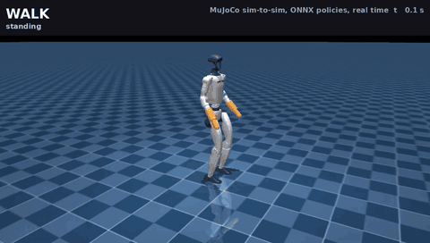 | 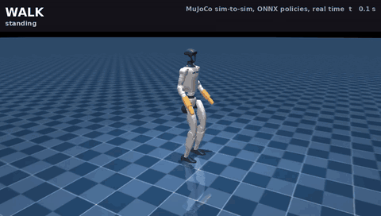 |
| [full video, 45 s (MP4)](media/sim/full_chain_creepy.mp4) | [full video, 46 s (MP4)](media/sim/full_chain_scuttle.mp4) |

*The whole sequence in MuJoCo with each crawl style: walk, stop, stand -> crawl, crawl
(forward, turn, forward), crawl -> stand, walk.*

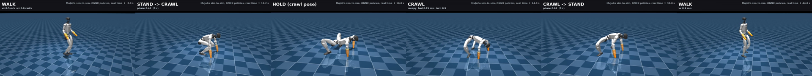

## On the real robot

| Crawl, recorded 2026-10-30 (2x speed) | Crawl in the sun (2.5x speed) |
|---|---|
| 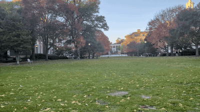 | 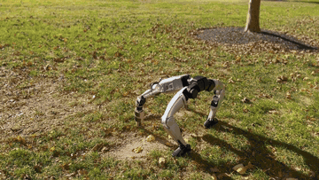 |
| [full video, 26 s (MP4)](media/real/real_crawl_2026-10-30.mp4) | [full video, 50 s (MP4)](media/real/real_crawl_sunny.mp4) |

The real G1 crawling with the sim-trained policies.
The videos are re-encoded (720p and 540p H.264, no audio) to keep the repo small.

The robot runs them with
[`real_world_implementation/`](real_world_implementation/README.md), either from a
laptop over Ethernet or onboard with the Unitree remote. See
[Real robot testing](#real-robot-testing).

## Motion sequence (simulation, real time)

| Walk -> stand-to-crawl | Crawl: creepy (default) |
|---|---|
| 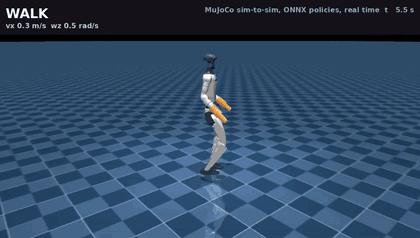 | 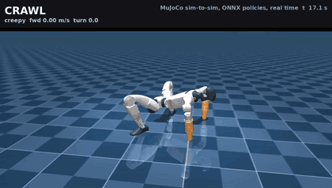 |
| **Crawl: scuttle** | **Crawl -> stand -> walk** |
|  | 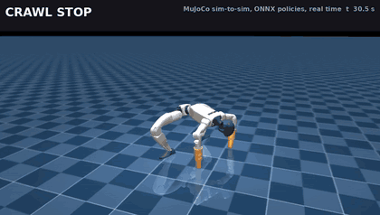 |

These are rendered from the deploy bundle with the same CPU loop the robot laptop runs
(ONNX policies, 50 Hz, IMU + encoder gates, no contact sensing):
`tools/render_chain_media.py`.

## What is in the repo

| Path | What |
|---|---|
| `deploy/g1_chain_v3_1/` | the deployable bundle: `walk.onnx`, `stand_crawl.onnx`, `crawl.onnx` (= `crawl_creepy.onnx`), `crawl_scuttle.onnx`, `chain.json` (joint order, PD gains, limits, observation layouts, keyframes, switcher gates) and `mujoco/` (robot + scene) |
| `deploy/sim2sim_chain_cpu.py` | standalone sim-to-sim of the whole chain: CPU MuJoCo + onnxruntime, built from the bundle alone |
| `deploy/thermal_guard.py` | motor-temperature guard for the real controller (numpy) |
| `deploy/VERSIONS.md` | bundle history and alternate checkpoints |
| `real_world_implementation/` | sim-to-real: the robot controller and its safety layer, the robot-tested v3 bundle, the onboard packager, log analysis, and a README with both ways to run it (laptop over Ethernet, or onboard with the Unitree remote) |
| `checkpoints/` | the PyTorch checkpoints behind the ONNX files |
| `training/` | the mjlab tasks, rewards, thermal model and scripts (an overlay on mjlab) |
| `hardware/wrist_brace/` | STL files to print the wrist braces + forearm extensions, with the bolt list |
| `tools/` | media rendering and the motor-heat plot |
| `media/` | GIFs, videos and figures |

## Policies

Three policies, one robot, switched by a state machine. Control runs at 50 Hz; every
policy outputs 25 joint position targets that a PD loop tracks (gains in `chain.json`).

| Policy | Inputs | Output -> joint target | Training |
|---|---|---|---|
| walk | 84 | `stand_pose + scale * clip(a, +-5)` | velocity tracking on rough terrain, mirror symmetry, pushes and heavy domain randomisation |
| stand <-> crawl | 108 | `ref(phi) + 0.5 * clip(a, +-1.6)` | residual on a keyframe schedule; one policy for both directions; thermal, carpet, shove, lag and weak-motor hardening |
| crawl (creepy / scuttle) | 88 | `crawl_pose + 0.5 * clip(a, +-5)` | command tracking from a retargeted crawl animation; thermal fine-tune; two gait styles |

### Observations (what the robot feeds the policies)

One frame, no history, raw SI units, no scaling. Training adds noise and an encoder
offset; on the robot you pass the clean readings.

| Term | Size | Source on the robot |
|---|---|---|
| gravity in the pelvis frame | 3 | IMU quaternion |
| pelvis angular velocity | 3 | IMU gyro (rad/s) |
| command | walk 3 `[vx, vy, wz]`; crawl 7 `[fwd, lat, turn, step_h, 0, 0, 0]`; stand <-> crawl none | joystick |
| joint position minus the reference pose | 25 | encoders (stand pose for walk and stand <-> crawl, crawl pose for crawl) |
| joint velocity | 25 | encoders (rad/s) |
| previous action | 25 | the same policy's last output, clipped |
| stand <-> crawl only: phase `[phi, dphi/dt]` | 2 | switcher timer (phi 0 = standing, 1 = crawl pose) |
| stand <-> crawl only: `ref(phi) - q` | 25 | keyframe schedule minus encoders |

Order: walk and crawl are `gravity | gyro | command | q - pose | qd | last_action`;
stand <-> crawl is `gravity | gyro | q - stand | qd | last_action | phi, dphi | ref - q`.

The 25 joints, in order: left leg (hip pitch, hip roll, hip yaw, knee, ankle pitch,
ankle roll), right leg (same), waist (yaw, roll, pitch), left arm (shoulder pitch,
shoulder roll, shoulder yaw, elbow, wrist roll), right arm (same). These are G1 motor
indices 0-19 and 22-26; the braced wrist pitch/yaw motors (20, 21, 27, 28) are held
at zero.

## The state machine

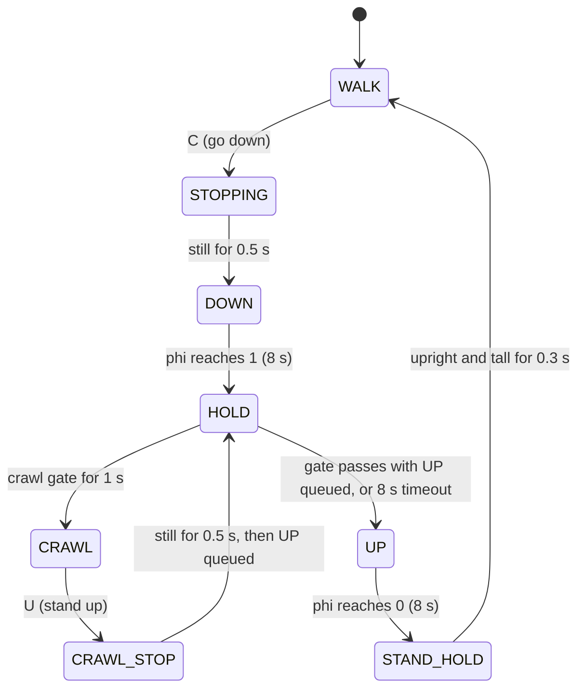

- Every policy runs every tick (shadow mode); targets blend over 0.5 s at hand-overs
  and are clamped to the joint limits.
- Crawl gate: joint speeds under 0.5 rad/s, gravity within 0.15 of the crawl pose's,
  pelvis 0.151 +- 0.03 m above the mean limb height (forward kinematics).
- Stand hand-over: gravity z below -0.94 and pelvis over feet above 0.66 m for 0.3 s.

## Temperature awareness

The first real-robot test of the crawl tripped the controller's 85 C thermal stop twice
while the robot was holding still: 8.8 Nm on a shoulder roll for 29 s, and 50 Nm on a
knee for 25 s. Nothing in training priced a steady 30-45 % load. The thermal fine-tunes
add:

- `motor_heat_rate`: copper loss goes with torque^2, so each motor's instant heat is
  `(tau / tau_continuous)^2`; convex, so it also spreads load across motors.
- `motor_heat_sustained`: the same averaged over the last seconds, penalised above a
  budget; strongest while holding still.
- `joint_pos_above`: keeps joints off their end stops (the real knees reached 2.88 rad).
- per-episode floor friction from tile to carpet, and carpet "twist" friction.
- a two-node (winding + housing) thermal model per motor, with cooling, driver heat and
  neighbour coupling (`training/src/mjlab/tasks/g1_motor_safety/motor_model.py`).

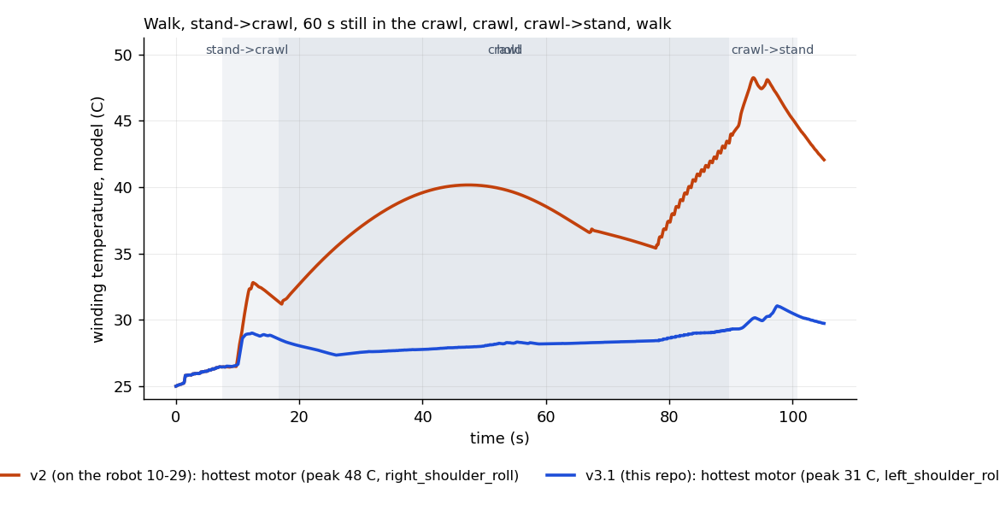

*Estimated winding temperature of the hottest motor over walk, stand -> crawl, a 60 s
still hold in the crawl, crawling, crawl -> stand and walk (motor model, passive cooling,
25 C ambient). The chain that overheated on the robot (v2, trot crawl) peaks at 48 C on
a shoulder roll; this release peaks at 31 C. The real motors heated about 2x faster than
the model, so read these as relative numbers.*

A longer session tells the same story. Five rounds of walking 1 min, going down,
crawling 6 min at 0.2-0.5 m/s (scuttle at 0.5-1 m/s), and standing up, 37 min in all,
with the heat model doubled to match the real knee and a 30 C room:

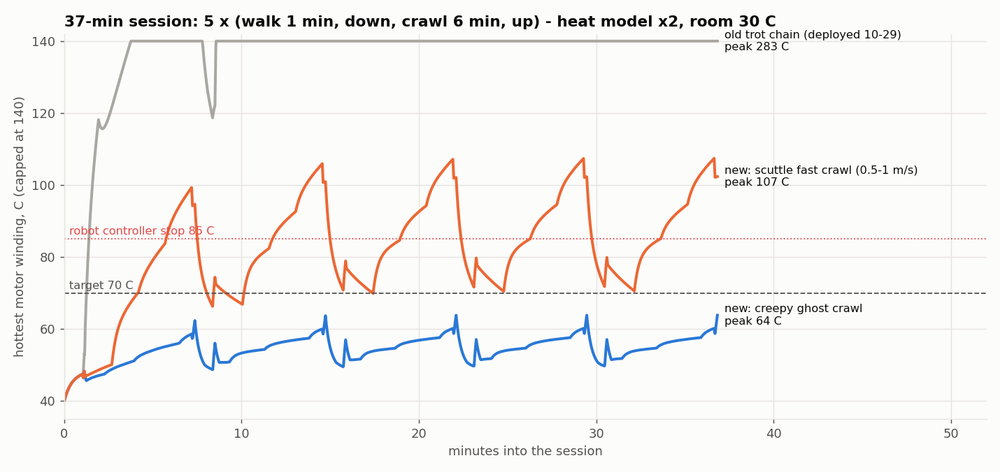

*Hottest motor winding over the session (motor model x2, 30 C room, plot capped at
140 C). The chain deployed on 10-29 runs away within minutes (the model's peak is
283 C). The creepy crawl, the default, settles under the 70 C target (peak 64 C). The
scuttle crawl peaks at 107 C when it is driven at 0.5-1 m/s for 6 min straight, so use
it for short fast stretches, not long runs.*

*Values above 85 C are not temperatures a motor reaches. This estimate
(`training/scripts/mission_thermal.py`) has no cut-off: it keeps adding the heat of
whatever torque the policy asks for. On the robot the controller stops at 85 C (the
10-29 runs hit it within 30-40 s), and the motor drivers have their own
over-temperature cut-out (modelled at 105 C). A curve far above 85 C means the load
cannot be held, not that the motor would get that hot.*

On the robot, `deploy/thermal_guard.py` watches both temperature readings of every
motor: warn at 65 C; at 72 C (or faster than 1 C/s above 55 C) on the crawl side it
stands the robot up; at 85 C it latches all motors to damping. Going down again is
blocked until every motor is back under 60 C.

## Robustness (simulation, chain v3.1 vs v3)

Stress tests with 8 s transitions and the deploy target clamp; 96 robots per condition,
1024 for the loop.

| Test | v3.1 | v3 |
|---|---|---|
| nominal, 60 % motor strength, +8 kg, stiffness x0.7/x0.8/x1.3, floor friction 0.25, 0.4 m/s push | 100 % stand up and walk | 100 % |
| 40 ms control lag | 93 % | 45-70 % |
| weak + heavy + slippery + lag, combined | 95 % | 44-58 % |
| carpet friction 1.0-1.5 | 100 % | 100 % |
| full loop, hard randomisation + 0.3 m/s pushes: failures | 3.8 % | 4.0 % |
| brace touching the floor while holding (of 1024) | 3 | 13 |
| holding heat, busiest motor vs its rating | 0.50x | 0.64x |
| CPU sim-to-sim variants passed (1 kHz PD, 40 ms lag, pushes, weak/heavy, scuttle) | 14 / 14 | 0 / 3 at 40 ms |

## Run it

Sim-to-sim on any computer (no GPU):

```bash
pip install mujoco onnxruntime numpy
python deploy/sim2sim_chain_cpu.py --bundle deploy/g1_chain_v3_1 --relaxed-handover --hold-timeout 8
python deploy/sim2sim_chain_cpu.py --bundle deploy/g1_chain_v3_1 --relaxed-handover --hold-timeout 8 --crawl-onnx crawl_scuttle.onnx
python deploy/sim2sim_chain_cpu.py --bundle deploy/g1_chain_v3_1 --relaxed-handover --hold-timeout 8 --pd-1khz --delay-steps 4 --push 0.3
```

It prints the state timeline and PASS/FAIL, and `--log run.npz` saves the same signals
the robot logs. Render videos and the heat plot:

```bash
pip install pillow imageio-ffmpeg matplotlib
MUJOCO_GL=egl python tools/render_chain_media.py --out media/sim/full_chain_creepy
```

For the real robot, see [Real robot testing](#real-robot-testing).

# Real robot testing

`real_world_implementation/` runs the chain on the G1 in two ways:

- **from a laptop over Ethernet**, driven from the keyboard;
- **onboard, on the G1's own computer**, driven by the Unitree remote, no cable.

Both use the same controller with the safety layer on: thermal guard, tilt,
joint-speed and late-step stops, and logging. The runs so far used bundle v3,
which ships in that folder.

**Before you start:**
- the robot hangs on a gantry or harness;
- the braces and forearm extensions are on, and the waist is unlocked;
- someone is ready on the e-stop.

```bash
cd real_world_implementation
pip install -r requirements-laptop.txt
pip install --no-deps -e controller/third_party/unitree_sdk2_python

# 1. checks, no robot needed
python controller/check_robot.py
python bundles/g1_chain_v3/sim2sim_mujoco.py --test all

# 2. laptop over Ethernet (laptop wired to the robot, address 192.168.123.x)
python controller/g1_chain_real.py --real --net enp3s0 --monitor        # read-only
python controller/g1_chain_real.py --real --net enp3s0 --wrists braced  # run

# 3. onboard (G1 computer, Unitree remote)
python controller/tools/make_onboard_package.py
scp -r build/g1_onboard unitree@192.168.123.164:~/
#    then on the robot:  cd ~/g1_onboard && ./build_vendor.sh   (first time only)
#                        cd ~/g1_onboard && NET=eth0 ./run_robot.sh
```

| | Keyboard (laptop) | Remote (onboard) |
|---|---|---|
| stand up slowly (still hanging) | `1` | Start |
| start the policies (feet carrying the weight) | `2` | R1 + X |
| move | `w` `s` `a` `d` `q` `e` (+0.1 each), `x` stop | left / right stick |
| walk → crawl / crawl → stand | `c` / `u` | R1 + Down / R1 + Up |
| **damping (e-stop)** | **Space** | **B** or **F1** |

Logs are saved to `real_world_implementation/controller/logs/` (copy them back
from the robot's `~/g1_onboard/logs/`).

## Training

`training/` mirrors the mjlab source tree. Apply it on top of mjlab:

```bash
git clone https://github.com/mujocolab/mjlab.git && cd mjlab
git checkout c2e1e0640
cp -r ../humanoid-crawl-with-G1-temperature-aware/training/{src,scripts,tests} .
uv sync
uv run pytest tests/test_g1_walk.py -q
```

Tasks (all `Unitree-G1-29dof`): `Mjlab-Walk-Rough-Sym-Hard-...` (walk),
`Mjlab-StandCrawl-Robust5-...` (stand <-> crawl),
`Mjlab-Crawl-Flat-Cmd7-CreepyHard-...` and `Mjlab-Crawl-Flat-Cmd7-ScuttleHard-...`
(crawls). Train, or fine-tune from `checkpoints/`:

```bash
C=../humanoid-crawl-with-G1-temperature-aware/checkpoints
CK="--walk-checkpoint $C/walk_hard_track_55499.pt --stand-crawl-checkpoint $C/stand_crawl_robust_v5_35197.pt --crawl-checkpoint $C/crawl_creepy_hard_59499.pt"
uv run train Mjlab-StandCrawl-Robust5-Unitree-G1-29dof --env.scene.num-envs 4096
uv run play Mjlab-StandCrawl-Robust5-Unitree-G1-29dof --checkpoint-file $C/stand_crawl_robust_v5_35197.pt --num-envs 16
uv run python scripts/play_chain.py $CK --relaxed-handover                     # drive it: C down, U up
uv run python scripts/play_chain.py $CK --relaxed-handover --eval 256 --hard --push 0.3
uv run python scripts/standup_stress.py $CK --relaxed-handover                 # the robustness table above
uv run python scripts/export_chain_v2.py --help                                # build a new deploy bundle
```

The crawl task's own notes are in `training/src/mjlab/tasks/g1_crawl/README.md` and
`TRAINING.md`.

## Wrist braces

Print files and the bolt list: [`hardware/wrist_brace/`](hardware/wrist_brace/).
Each brace locks wrist pitch and yaw and ends in a 50 mm rounded foot 225.5 mm from
the wrist-roll joint, the same geometry the policies were trained with.

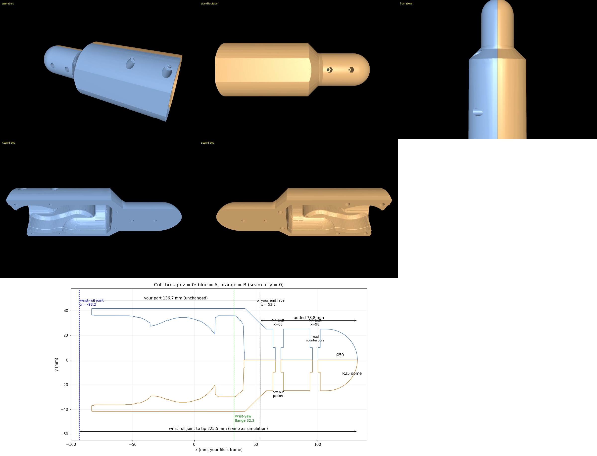

## Credits

- [mjlab](https://github.com/mujocolab/mjlab) (Apache-2.0): the training framework;
  `training/` builds on it (license in `training/LICENSE.mjlab`).
- Unitree G1 model and meshes from Unitree / MuJoCo Menagerie (BSD-3-Clause).
- [MuJoCo](https://github.com/google-deepmind/mujoco), [RSL-RL](https://github.com/leggedrobotics/rsl_rl).

Author: [@bethalageetachandraraju](https://github.com/bethalageetachandraraju)

## Disclaimer

Running these policies on a real G1 can damage the robot or hurt people.
**Before any real-robot test, read
[`real_world_implementation/README.md`](real_world_implementation/README.md) in
full**: the operator procedure, the safety stops, and the tests to pass first.
Always start on a gantry or harness with someone on the e-stop. Use at your own
risk.
