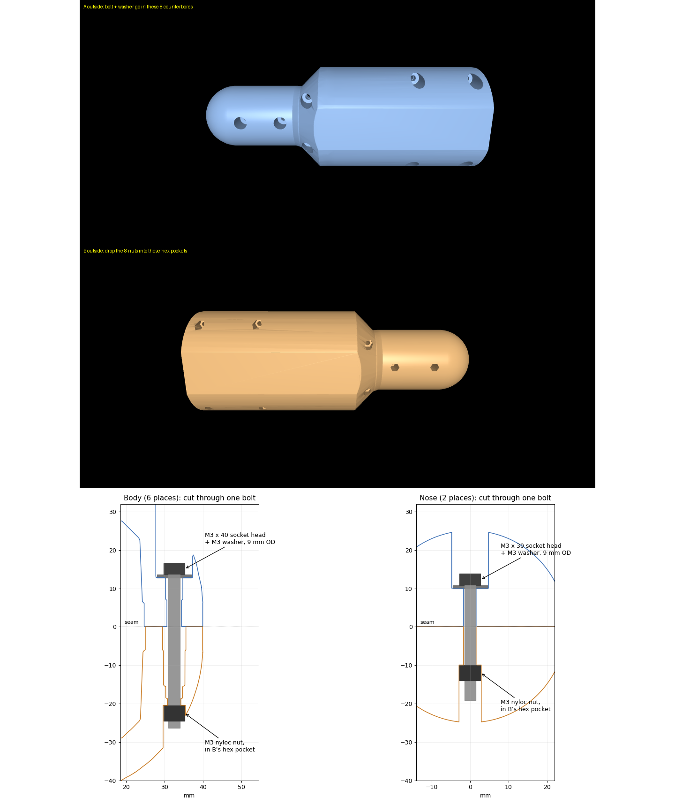

# Wrist brace + forearm extension (print files)

The crawl uses the forearms as front legs. Each brace locks wrist pitch and yaw
at zero (wrist roll stays free) and ends in a 50 mm cylinder with a R25 dome
tip, **225.5 mm from the wrist-roll joint**, exactly as in the simulation
(`training/src/mjlab/tasks/g1_crawl/robot29.py`). The policies were trained
with this geometry, so print it as is.

| File | What |
|---|---|
| `left_A_cap_v2_ext.stl` / `right_A_cap_v2_ext.stl` | cap half (screw-head side) with its half of the extension |
| `left_B_carrier_v2_ext.stl` / `right_B_carrier_v2_ext.stl` | carrier half with hex nut pockets and the other half of the extension |
| `check_report.txt` | geometry checks: watertight, tip distance, seam gap, bolt positions |
| `generator/` | the scripts that made them (`add_brace_extension.py`; `make_wrist_brace*.py` for the earlier split-clamp and fit-test designs) |

The right parts are the left parts mirrored. Left and right are not interchangeable.
Each half is about 222-228 cm3 of plastic.

## Print

- PETG at least; ASA or PA-CF is better (the motors run warm, and PETG creeps under bolts).
- Flat seam face on the bed, cavity up. The parts are 216 mm long.
- Tree supports from the build plate only (never inside the cavity), 5 mm brim.
- 5 walls, 40 % gyroid, 0.2 mm layers.

## Hardware (per arm, double for both)

| Qty | Part |
|---|---|
| 6 | M3 x 40 socket-head screw (body) |
| 2 | M3 x 30 socket-head screw (nose, through the extension) |
| 8 | 9 mm OD M3 washer (DIN 9021) under each head |
| 8 | M3 nyloc nut, in the hex pockets of B |

Tighten to 0.3-0.4 Nm: snug, not hard (the halves clamp the wrist through the
seam; over-tightening cracks PETG). Check the bolts after every session; they
loosen under the crawl's impacts.

## Loads (from simulation)

Tip loads while crawling: median 120 N along the forearm, p99.9 about 1 kN.
Bending stress stays under about 7 MPa even at 2x those loads. The weak points
are the dome on a hard floor (it lands on the seam), play in the clamp, and
bolts working loose.
