# Motor-safe G1 walking: proof-of-concept results

*2026-10-25. Simulation only (mjlab / MuJoCo Warp, RTX 5090). One training seed per arm.
Design and code: [`README.md`](README.md).*

## Short answer

**Yes, the idea is useful, and the experiment shows why.** It also shows that the safety
filter on its own is not the answer.

1. **Ignoring motor heat in simulation is a real failure mode.** A walking policy trained
   the usual way (ideal motors) runs a G1's windings past their rating within minutes.
   **63 % of robots fall within 8 minutes, and every one of those falls is a firmware
   overheat cut-off.** In a hot room the figure is 98 %. Today's simulators never show
   this.
2. **The thermal safety filter works as a guarantee.** No winding passed 90 C in any test,
   for any policy run with the filter, even with the plant parameters 4-20 % off the
   identified values and a hot room the policies never trained in.
3. **A filter added only at deployment trades motor failures for falls.** The motors stay
   safe, but the policy was never trained against a torque budget. In the hot-room test
   39 % of robots fall (51 % at 8 kg, 100 % at 12 kg). This is the "myopic filter"
   problem: the filter protects the motors, not the robot.
4. **Training the policy inside the filter fixes that.** The policy observes its motor
   temperatures and headroom.
   - It learns a gait that keeps the hottest motor (ankle pitch) about 30 C cooler.
   - It falls 0 % at room temperature and 1.2 % in the hot room (only at 12 kg, which is
     beyond its training range).
   - It never exceeds the rating.
   - The filter almost never has to step in.
   - Cost: 4-16 % more velocity tracking error than the ideal-motor policy.
5. **A reward penalty on temperature looks almost as good in-distribution, but has no
   guarantee.**
   - At room temperature it is as safe as the filter arm and tracks slightly better.
   - In the hot room 2.5 % of robots pushed a winding past the rating (up to 99 C, 10 % of
     the 12 kg robots).
   - The in-filter policy run *without* the filter also overheats there (11.7 %).
   - So the filter, not the training alone, is what gives the guarantee.

For a paper the core story holds: identified motor model, then a hard thermal and
feasibility constraint, then a policy trained inside it, gives zero overload with almost
no fall cost. The open gap is the second failure mode. Falls are handled by learning
here, not certified; see [What a strong paper still needs](#what-a-strong-paper-still-needs).

## Setup

**Robot and task.** mjlab's 29-DoF G1 walks flat ground following velocity commands,
carrying a torso payload of 0-8 kg (per env).
- Training uses the stock velocity-tracking reward.
- Evaluation is a fixed 60 s work cycle, repeated: stand 8 s, 1.0 m/s 20 s, walk and turn
  10 s, sidestep 6 s, backwards 6 s, walk and turn 10 s.

**Motor model** (`motor_model.py`):
- The PD set-point law of the G1 driver.
- mjlab's DC-motor torque-speed envelope (`dc_motor_clip`).
- Per joint, a two-node heat model (winding and housing): copper loss
  `R(T) I^2`, `I = tau / (n gear kt)`, plus speed loss.
- Firmware cut-off at 105 C (zero torque until the winding cools to 85 C).
- Temperature readings quantized to 1 C.
- Per-env "true" parameters spread 4-20 % around the identified ones; room 20-30 C.
- Electrical and thermal values are plausible stand-ins: continuous torque is about 26 % of
  peak; time constants are 10-25 s for windings and 3-7 min for housings.

**Identification** (`scripts/motor_safety/sysid_thermal.py --synthetic`):
- Fits the heat model from logs of torque estimate, speed and the two temperature readings,
  which is exactly what the G1 reports.
- Temperatures alone fix the parameters only up to one common scale. The filter's bound
  depends only on scale-free groups, so one electrical measurement anchors the rest.
- On synthetic logs from a hidden "true" motor (40 min fit, 20 min held out, 1 C readings):

| motor | filter groups error | held-out winding error (rmse / max) | nominal model, max error |
|---|---|---|---|
| 7520-22 (knee) | 0.6 % / 0.1 % | 0.08 / 0.20 C | 7.1 C |
| 7520-14 (hip) | 0.0 % / 0.1 % | 0.03 / 0.08 C | 26.8 C |
| 5020 x2 (ankle) | 1.3 % / 0.1 % | 0.13 / 0.31 C | 1.0 C |

**Safety filter.** Each 5 ms motor tick, the PD torque is clamped to the intersection of
two bounds:
- **90 % of the torque-speed envelope**: the hard feasibility constraint.
- **A discrete-time thermal barrier** on `90 C - T_w`, at the worst corner of the
  identified uncertainty box and the sensor quantization.

Invariance is checked by `tests/test_g1_motor_safety.py`.

**Training** (PPO, 4096 envs, mjlab's G1 velocity recipe):
- One base policy on ideal motors (3000 iterations, about 1 h).
- Then three arms fine-tuned from it for 1500 iterations each, all seeing the same
  observations: stock velocity observations plus two temperature readings and the
  thermal headroom per motor.
  - **ideal**: ideal PD motors, flat torque clamp, heat has no effect. This is today's
    practice.
  - **penalty**: the realistic motor plus a squared-hinge reward penalty on windings above
    75 C (the soft-constraint approach of recent thermal-aware RL).
  - **filter (ours)**: the realistic motor with the safety filter in the loop, plus a small
    penalty on how much the filter holds back.
- Training episodes start from random motor temperatures, so 20 s episodes cover the whole
  thermal range.

**Evaluation** (`scripts/motor_safety/eval_motor_safety.py`):
- The realistic motor model, a cold start (motors at room temperature), sensor noise on,
  deterministic actor.
- Payload groups 0/2/4/6/8 kg, 1000 robots, 8 minutes.
- A stress test: 35-40 C room, payloads 0/4/8/12 kg, 600 robots, 10 minutes.

## Results: 8 minutes, room 20-30 C (training conditions)

| variant | fell | motor cut | above 90 C | peak winding (mean / max) | vel err m/s | yaw err rad/s |
|---|---|---|---|---|---|---|
| ideal-motor policy | 62.8 % | 62.8 % | 96.9 % | 102.3 / 105.1 C | 0.143 | 0.159 |
| ideal-motor policy + filter at deploy | 0.9 % | 0 % | **0 %** | 86.0 / 88.6 C | 0.168 | 0.173 |
| heat-penalty policy | 0.2 % | 0 % | 0 % | 70.8 / 85.3 C | 0.154 | 0.183 |
| **trained in filter + filter** | **0.0 %** | 0 % | **0 %** | 71.6 / 86.2 C | 0.166 | 0.183 |
| trained in filter, filter removed | 0.0 % | 0 % | 1.1 % | 72.1 / 93.7 C | 0.166 | 0.183 |

Fall rate by payload (0 / 2 / 4 / 6 / 8 kg):
- ideal: 38 / 58 / 65 / 73 / 79 %.
- ideal + filter: 0 / 0 / 0 / 0 / 4.5 %.
- penalty: 0 / 0 / 0.5 / 0.5 / 0 %.
- trained in filter: 0 % everywhere.

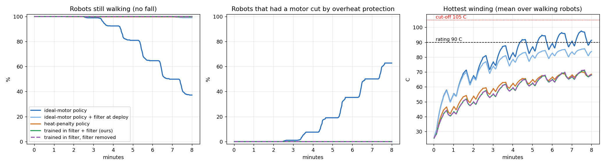

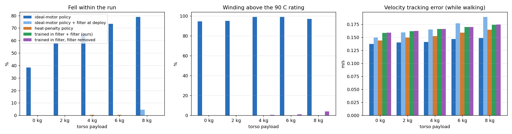

The bottleneck motor is the **ankle pitch**, the small dual 5020 motors.
- For the ideal-motor policy it peaks at 102 C, and every other joint stays under 40 C.
- Both heat-aware policies learned gaits that keep it at about 71 C, with knee and hip
  temperatures almost unchanged.
- With the filter added only at deployment, the ankle sits at the limit (86 C) and the
  knees and hips heat up as they compensate.

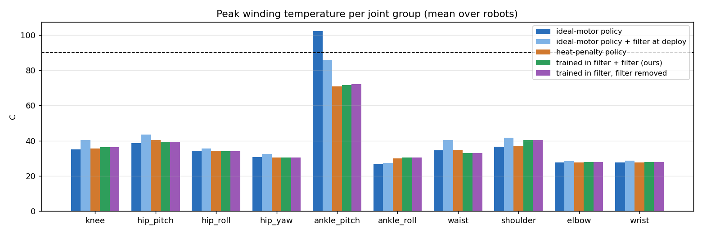

## Results: stress test, 35-40 C room, payload up to 12 kg, 10 minutes

Both conditions are outside the training distribution (20-30 C, 0-8 kg).

| variant | fell | motor cut | above 90 C | peak winding (mean / max) | vel err m/s |
|---|---|---|---|---|---|
| ideal-motor policy | 98.2 % | 98.2 % | 100 % | 104.9 / 105.1 C | 0.139 |
| ideal-motor policy + filter at deploy | 39.3 % | 0 % | **0 %** | 87.3 / 88.6 C | 0.186 |
| heat-penalty policy | 0.3 % | 0 % | **2.5 %** | 78.6 / **99.4** C | 0.137 |
| **trained in filter + filter** | 1.2 % | 0 % | **0 %** | 80.5 / 88.9 C | 0.145 |
| trained in filter, filter removed | 0.2 % | 0.2 % | 11.7 % | 82.4 / 105.0 C | 0.145 |

Fall rate by payload (0 / 4 / 8 / 12 kg):
- ideal: 95 / 97 / 100 / 100 %.
- ideal + filter: 0 / 6 / 51 / 100 %.
- penalty: 0 / 0 / 0 / 1 %.
- trained in filter + filter: 0 / 0 / 0 / 5 %.

Robots above the rating, by payload:
- penalty: 0 / 0 / 0 / 10 %.
- trained in filter without the filter: 0 / 3 / 14 / 30 %.

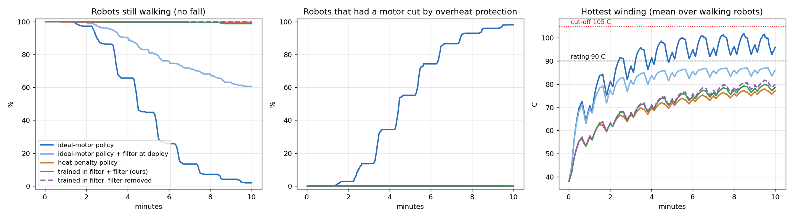

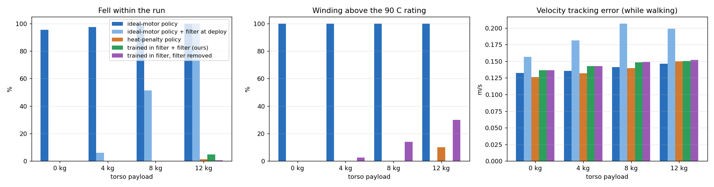

## Part 2 (2026-10-25): fan cooling, HJ safety and an HJ reference governor

### Short answer (Part 2)

- **The fan cooling model is in**, following the whole-body thermal networks of Lin et
  al. (ROBOT 2025), as used by Wan et al. and Qian et al. for thermal-aware RL: fan
  duty from winding temperature, airflow while walking, driver heat, neighbour
  coupling.
- **HJ safety filter v1 does not work.** It keeps motors safe but chatters, swapping
  policies mid-stride, and robots fall (14 % at room temperature, 25 % hot, 57-77 % in
  the extreme tests).
- **Falls must be in the failure set.** With a motor-only margin the learned fallback
  goes limp, because lying down keeps motors cool.
- **The HJ reference governor works.** It learns the safety value of the whole closed
  loop (clip-trained policy + clip filter + real motors) as a function of the command,
  and slows or stops the command when walking on would end in a fall.
  - In two extreme regimes on held-out robots, it is the only method with no motor
    over rating and the fewest falls in both: 0 % at 40-45 C, and 17 % at 45-50 C
    with up to 24 kg.
  - In the harsh room it is as safe as the most conservative rules (derating 18.5 %,
    standing 20 %: within noise), but it still does 74 % of the mission against 58 %
    for derating. At 40-45 C it costs nothing (94 % against 95 %).
  - At 18 kg in the harsh room: 2 % falls, against 30 % for the same policy without
    the governor.
  - At 24 kg every method fails.
- **What it took:** a target network for the value, and a threshold of 0.3 / 0.6
  picked by a sweep, then confirmed on fresh robots.

Everything below runs on the **cooled plant**. Each motor gets a fan (off below 40 C,
full at 60 C), extra cooling while walking, constant heat from the motor driver, and
heat sharing between neighbouring motors (README, "The motor model"). Part 1 ran
without cooling, so its numbers are not directly comparable.

### HJ safety filter v1: learned fallback + value, switch when V is low

Method (README, "The Hamilton-Jacobi safety filter"):
- The safety margin is motor temperature only, `g = (90 C - hottest winding) / 10 C`;
  a fall ends the episode as a failure.
- Avoid Bellman backup from `safety_sb3`, inside rsl_rl PPO.
- The fallback learns from handover states: a frozen task policy drives first.
- At deployment the task policy acts while `V > 0.2`; the fallback takes over until
  `V > 0.5`.

Two training bugs had to be fixed first:
- rsl_rl's adaptive learning rate read the float-noise KL of the frozen actor as "too
  cautious" and ramped to 1e-2, so the first actor update wrecked the walker.
- The entropy bonus inflated the action noise (0.37 -> 0.54), which caused falls; it
  is now 0.

**Room, 20-30 C, 0-8 kg, 8 min, 1000 robots:**

| variant | fell | motor cut | above 90 C | hottest winding (mean / max) | vel err m/s |
|---|---|---|---|---|---|
| normal RL | 5.1 % | 5.1 % | 47.2 % | 89.4 / 105.0 C | 0.141 |
| normal RL + clip filter | 0 % | 0 % | 0 % | 80.6 / 87.5 C | 0.149 |
| trained in clip + clip filter | 0 % | 0 % | 0 % | 73.4 / 83.7 C | 0.128 |
| normal RL + HJ safety filter v1 | **13.8 %** | 0 % | 0 % | 83.7 / 88.0 C | 0.155 |
| normal RL + HJSF v1 + clip | 4.5 % | 0 % | 0 % | 80.5 / 85.0 C | 0.149 |
| heat-penalty RL | 0 % | 0 % | 0 % | 63.6 / 78.3 C | 0.151 |

**Hot room, 35-40 C, 0-12 kg, 10 min, 600 robots:**

| variant | fell | motor cut | above 90 C | hottest winding (mean / max) | vel err m/s |
|---|---|---|---|---|---|
| normal RL | 33.5 % | 33.5 % | 96.0 % | 99.6 / 105.1 C | 0.138 |
| normal RL + clip filter | 19.0 % | 0 % | 0 % | 84.8 / 88.3 C | 0.158 |
| trained in clip + clip filter | **0 %** | 0 % | 0 % | 78.3 / 85.0 C | **0.118** |
| normal RL + HJ safety filter v1 | 25.3 % | 0 % | 1.0 % | 86.4 / 97.4 C | 0.266 |
| normal RL + HJSF v1 + clip | 33.3 % | 0 % | 0 % | 84.2 / 86.5 C | 0.157 |
| heat-penalty RL | 0.2 % | 0 % | 0.3 % | 71.7 / 92.3 C | 0.132 |

Fall rate by payload, hot room (0 / 4 / 8 / 12 kg):
- normal RL: 3 / 23 / 45 / 63 %.
- RL + clip: 0 / 0 / 5 / 71 %.
- RL + HJSF v1: 9 / 4 / 19 / 69 %.
- clip-trained + clip: 0 % everywhere.

**HJSF v1 keeps the motors safe but knocks the robot over.**
- It hands control over about 10 times a minute at 8 kg, while the fallback drives
  only 5 % of the time: half-second bursts.
- Every handover swaps one walking policy for another mid-stride.
- The value net was trained almost only on fallback-driven states (its input includes
  the last action), so on states the task policy drives it reads low, triggers a
  handover, and reads high again once the fallback's own actions are in the input.

**Ablation: falls must be in the failure set.** With a motor-only failure set (a fall
ends the episode but is not scored as a failure), the fallback learns to go limp and
collapse: lying down keeps motors cool. In training, collapse terminations rose from
0 to about 11 per log interval. In video, 2 of 3 robots fall with cut-offs where the
full method keeps all 3 up.

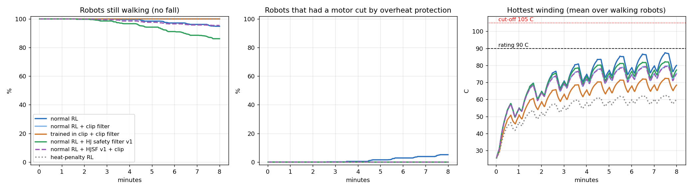

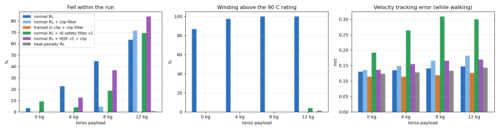

### HJ reference governor v2 (ours)

Same HJ value machinery, no policy switching: the governor scales the *command* the
walking policy follows (README, "The HJ reference governor").
- `V(s, c)`: the safety value of the closed loop "walking policy + clip filter + real
  motors, holding command `c`".
- Each 0.1 s, send the largest fraction of the user's command that V certifies.
- If no fraction is certified, send the one with the highest value (usually standing).
- The clip filter stays on as the hard per-step motor guarantee.

Building it turned up three things:
- **The value needs a target network.** Bootstrapping from the online net made V
  oscillate: the min in the avoid backup spreads any pessimistic error upstream, and
  with gamma near 1 errors decay slowly. Without one, up to 35 % of states briefly
  had V < 0 with no falls at all. With a Polyak target net, V < 0 stays at 0.5-8 %
  of states, in line with how often robots in those runs actually fall.
- **The threshold.** Under the clip filter `g >= 0`, so `V < 0` only where a fall is
  predicted. That argues for a threshold just above zero (0.05, and 0.15 to speed back
  up); the tests below show it is too permissive.

### Extreme test v1: 40-45 C room, 0/8/12/16 kg, 15 min patrol without rest

All methods run in one simulation, 200 robots each, so they share rooms, payloads
and plant draws (`scripts/motor_safety/eval_extreme.py`). The patrol: 40 s at 1 m/s,
10 s walking and turning, 10 s walking with a side step, repeated. The clip policy
here is fine-tuned on 0-16 kg and 20-45 C rooms (600 iterations from the cooled clip
arm). This run used governor v1: no target network, a 0.1 threshold, and standing as
the fallback.

| method | fell | motor cut | above 90 C | mission completed | fell by payload 0/8/12/16 kg |
|---|---|---|---|---|---|
| normal RL | 82.0 % | 82.0 % | 100 % | 35 % | 36 / 92 / 100 / 100 % |
| RL + clip filter | 61.0 % | 0 % | 0 % | 51 % | 0 / 44 / 100 / 100 % |
| heat-penalty RL | 4.5 % | 4.0 % | 11.5 % | 88 % | 0 / 0 / 0 / 18 % |
| RL + HJSF v1 | 57.0 % | 0 % | 3.0 % | 20 % | 18 / 24 / 86 / 100 % |
| clip-trained + clip | **0 %** | 0 % | 0 % | **95 %** | 0 % |
| + temperature derating (75 -> 88 C) | 0 % | 0 % | 0 % | 82 % | 0 % |
| + temperature derating (60 -> 85 C) | 0 % | 0 % | 0 % | 47 % | 0 % |
| + HJ governor v1 | 1.0 % | 0 % | 0 % | 94 % | 0 / 0 / 0 / 4 % |
| clip-trained + clip, standing still | 0.5 % | 0 % | 0 % | 0 % | 0 / 0 / 0 / 2 % |

Inside the envelope it was trained on, the clip-trained policy is already perfect, so
there is nothing left for a governor to fix. Governor v1 never slowed a robot: it stayed
at full speed for the whole mission. So its 4 % at 16 kg against the plain policy's 0 % is
the same controller on different robots, 2 of 50, which is noise.

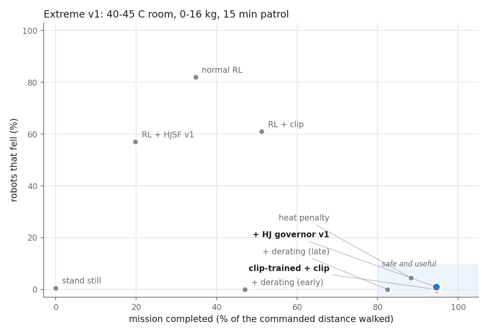

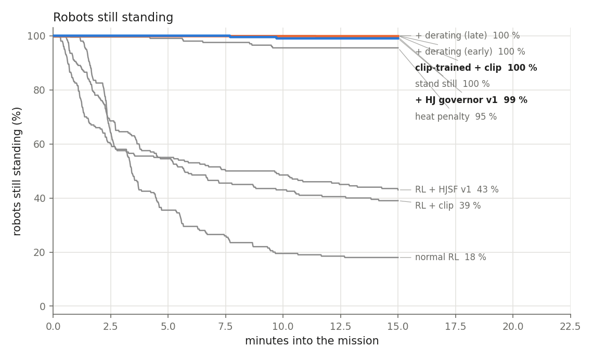

### Harsh test: 45-50 C room, 0/12/18/24 kg, 15 min patrol (seed 0)

Beyond anything the walking policies were trained on: up to 24 kg, rooms up to 50 C.
The governor value for the clip policy is trained on 0-24 kg and 20-52 C rooms (600
iterations, target network). This run used the near-zero threshold (0.05 / 0.15) and a
conservative one (0.1 / 0.25).

| method | fell | motor cut | above 90 C | mission completed | fell by payload 0/12/18/24 kg |
|---|---|---|---|---|---|
| normal RL | 85.5 % | 69.5 % | 86.0 % | 24 % | 42 / 100 / 100 / 100 % |
| RL + clip filter | 75.0 % | 0 % | 0 % | 29 % | 0 / 100 / 100 / 100 % |
| RL + clip + governor | 75.0 % | 0 % | 0 % | 29 % | 0 / 100 / 100 / 100 % |
| heat-penalty RL | 36.5 % | 19.5 % | 35.0 % | 63 % | 0 / 0 / 46 / 100 % |
| RL + HJSF v1 | 77.5 % | 0 % | 11.5 % | 8 % | 10 / 100 / 100 / 100 % |
| clip-trained + clip | 30.5 % | 0 % | 0 % | 75 % | 0 / 0 / 30 / 92 % |
| + temperature derating | 16.5 % | 0 % | 0 % | 59 % | 0 / 0 / 2 / 64 % |
| + governor (0.05 / 0.15) | 29.0 % | 0 % | 0 % | 76 % | 0 / 0 / 26 / 90 % |
| + governor (0.1 / 0.25) | 27.0 % | 0 % | 0 % | 77 % | 0 / 0 / 22 / 86 % |
| clip-trained + clip, standing still | 17.5 % | 0 % | 0 % | 0 % | 0 / 0 / 14 / 56 % |

The same 10 methods also ran in the 40-45 C test (seed 0). The governor on the clip
policy never slowed a robot there (0.5-1 % falls, against 0 % for the plain policy:
noise), and on RL + clip it slowed by only 10-15 % and fell as often (61 %).

**Why the near-zero threshold fails.** With gamma 0.999 the value mixes the margin it
sees now with a fall far ahead: a fall 30 s away lowers V by only about 0.2-0.3. So V
rarely drops below 0.05 until the fall is seconds away, and slowing down by then is too
late.

**The RL + clip governor did not help.** It slowed robots by 10-15 % and they fell as
often. A governor can only choose among the behaviours its policy has. The ideal-motor
policy may have none that survives 12 kg under the clip filter, but I did not test
whether it can even stand there.

### Threshold sweep (seed 1, both regimes)

Same robots for every method within a regime (one simulation per regime).

| method | harsh: fell | harsh: completed | 40-45 C: fell | 40-45 C: completed |
|---|---|---|---|---|
| clip-trained + clip | 29.5 % | 76 % | 0 % | 94 % |
| + temperature derating | 18.5 % | 58 % | 0 % | 83 % |
| standing still | 20.5 % | 0 % | 0 % | 0 % |
| + governor (0.2 / 0.4) | 24.5 % | 78 % | 0 % | 94 % |
| **+ governor (0.3 / 0.6)** | **18.0 %** | **74 %** | **0 %** | **95 %** |
| + governor (0.5 / 0.8) | 17.0 % | 37 % | 0 % | 66 % |

Harsh falls by payload (0/12/18/24 kg): derating 0 / 0 / 0 / 74 %, governor (0.3)
0 / 0 / 2 / 70 %, plain clip 0 / 0 / 24 / 94 %.

At 0.3 / 0.6 the governor falls as rarely as the conservative rules (derating, standing)
in the harsh regime, completes 16 points more of the mission than derating, and costs
nothing in the milder regime (95 % against 94 % for the plain policy, 83 % for
derating). 0.5 buys one more point of safety for half the mission. The threshold was
picked here, so the confirmation below uses fresh robots.

### Confirmation on fresh robots (seed 2): every method, governor at 0.3 / 0.6

**40-45 C room, 0/8/12/16 kg, 15 min patrol, 200 robots per method:**

| method | fell | motor cut | above 90 C | mission completed | fell by payload 0/8/12/16 kg |
|---|---|---|---|---|---|
| normal RL | 84.5 % | 84.5 % | 100 % | 34 % | 48 / 90 / 100 / 100 % |
| RL + clip filter | 65.0 % | 0 % | 0 % | 50 % | 0 / 60 / 100 / 100 % |
| heat-penalty RL | 3.0 % | 2.5 % | 11.5 % | 89 % | 0 / 0 / 0 / 12 % |
| RL + HJSF v1 | 57.0 % | 0 % | 5.5 % | 22 % | 10 / 22 / 96 / 100 % |
| clip-trained + clip | **0 %** | 0 % | 0 % | **95 %** | 0 % |
| + temperature derating | 0 % | 0 % | 0 % | 83 % | 0 % |
| standing still | 0 % | 0 % | 0 % | 0 % | 0 % |
| **+ HJ governor (ours)** | **0 %** | 0 % | 0 % | **94 %** | 0 % |

**45-50 C room, 0/12/18/24 kg, 15 min patrol, 200 robots per method:**

| method | fell | motor cut | above 90 C | mission completed | fell by payload 0/12/18/24 kg |
|---|---|---|---|---|---|
| normal RL | 87.5 % | 72.5 % | 88.0 % | 23 % | 50 / 100 / 100 / 100 % |
| RL + clip filter | 75.0 % | 0 % | 0 % | 29 % | 0 / 100 / 100 / 100 % |
| heat-penalty RL | 31.5 % | 14.0 % | 32.5 % | 65 % | 0 / 0 / 26 / 100 % |
| RL + HJSF v1 | 76.5 % | 0 % | 5.0 % | 10 % | 10 / 96 / 100 / 100 % |
| clip-trained + clip | 31.0 % | 0 % | 0 % | 76 % | 0 / 0 / 30 / 94 % |
| + temperature derating | 18.5 % | 0 % | 0 % | 58 % | 0 / 0 / 6 / 68 % |
| standing still | 20.0 % | 0 % | 0 % | 0 % | 0 / 0 / 0 / 80 % |
| **+ HJ governor (ours)** | **17.0 %** | 0 % | 0 % | **74 %** | **0 / 0 / 2 / 66 %** |

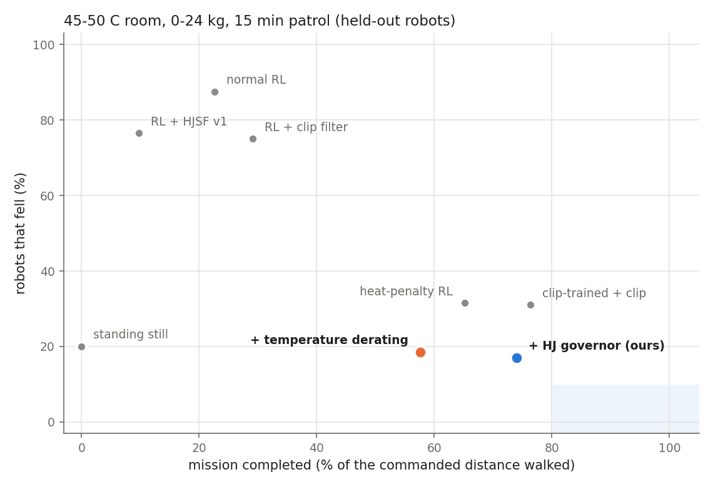

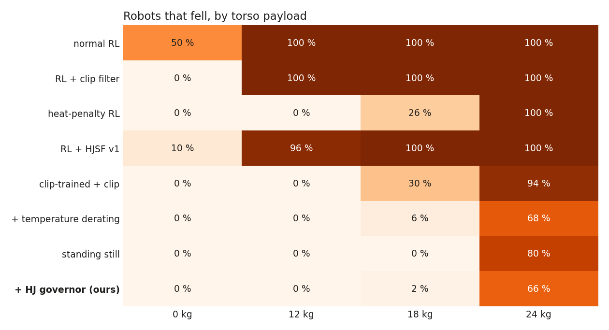

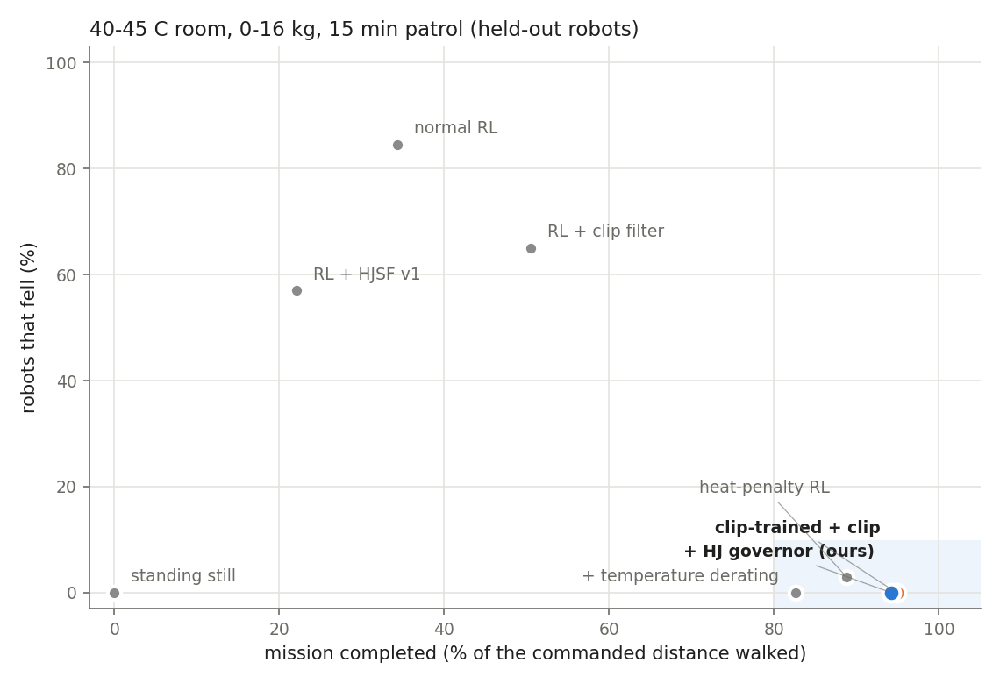

What the held-out runs show:
- **Every method without the motor safety filter fails in both regimes.** Normal RL
  falls 85-88 %. The heat penalty falls 3-32 % and puts 12-33 % of robots above the
  90 C rating, with firmware cut-offs.
- **The clip filter alone is not enough.** RL + clip falls 65-75 %. A policy trained
  inside it is perfect at 40-45 C, but loses 30 % of its robots at 18 kg in the harsh
  room.
- **HJ safety filter v1 fails everywhere** (57-77 % falls): the switching problem.
- **With the governor, no motor ever passed its rating, and it had the fewest falls
  of any method in both regimes** (0 % and 17 %). It costs nothing when conditions
  are fine (94 % of the mission against 95 % without it) and completes 16 points more
  of the harsh mission than the derating rule, the next-safest method that still walks.
- **At 18 kg, the clearest case:** 2 % falls, against 30 % for the same policy without
  the governor, 6 % with derating and 26 % for the heat penalty.
- **At 24 kg everything fails** (66-100 % falls). The governor can only slow down or
  stop, and that is not enough there; standing still loses 80 %.
- **Statistics, honestly:** in the harsh room, 17.0 % against 18.5 % (derating) and
  20.0 % (standing) is within noise for 200 robots. The governor is as safe as the most
  conservative rules, not clearly safer. Its win is that it is that safe while still
  doing three quarters of the mission. The 18 kg gap to the plain policy (2 % against
  30 %, 50 robots each) is well outside noise.

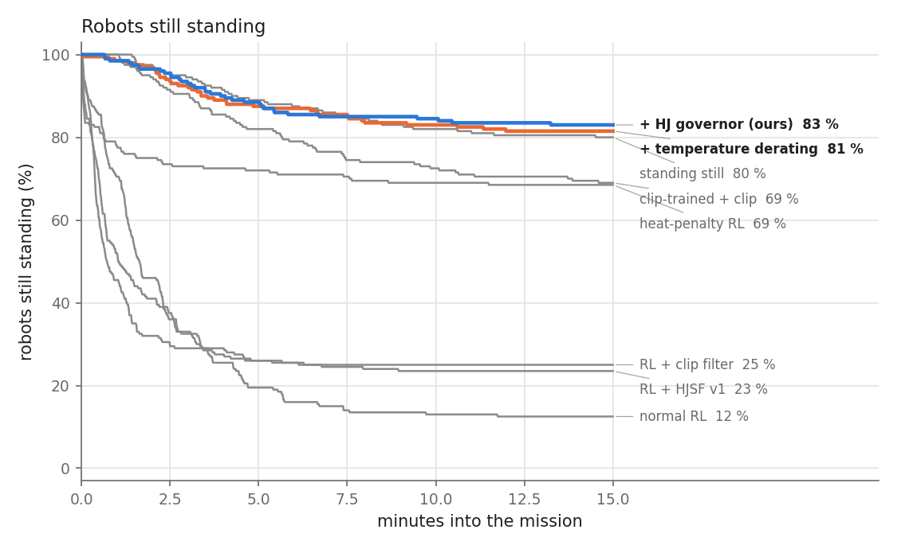

## What the experiment does and does not show

**Shows:**
- The motor-overload failure is large and invisible to standard sim training.
- A model-based thermal barrier plus feasibility clamp gives a hard per-joint guarantee
  that holds under parameter mismatch and out of distribution.
- That guarantee is only useful when the policy is trained inside it; otherwise it causes
  falls.
- A soft penalty does not carry its safety out of distribution.

**Does not show:**
- **Real-robot transfer.** The electrical and thermal values are stand-ins, and the sysID
  is on synthetic logs. Absolute minutes-to-overheat depend on them.
- **Statistical strength.** One seed per arm. The penalty and filter arms differ by about
  1 % of falls, which may be within seed variation.
- **A certificate for falls.** The 1.2 % hot-room falls of our policy (12 kg, beyond its
  training range) are the cases where the robot has to give up speed or stop and does not
  know it. Today nothing certifies that.
- **Fidelity at the ankle and waist.** These linkages are modelled as independent motors
  per joint; on the G1 two motors share pitch and roll, so the real ankles are hotter
  than modelled. There is one heat node per motor, no sensor lag, and no inter-motor
  heat coupling.

**Part 2 does not show:**
- **A certificate.** The governor's value is learned. It cut falls, but it guarantees
  nothing: it fell 17 % in the harsh room, mostly at 24 kg.
- **A tuning-free method.** The threshold was picked by a sweep (seed 1) and confirmed on
  fresh robots (seed 2), in the same two regimes. A third regime, or the real robot,
  is the real test.
- **Statistical separation from the conservative rules** in the harsh room (17 %
  against 18.5-20 %, 200 robots each). The separation is in mission completed.
- **Seeds.** One training seed per policy and per value.

## What a strong paper still needs

1. **Real sysID on the G1:** log `tau_est`, joint speed and the two temperature readings
   during long walks, squats and holds; fit with `sysid_thermal.py`; validate on held-out
   logs; set the uncertainty box from the residuals.
2. **The second certificate:** a learned reach-avoid value for falls (the sandbox's HJ
   machinery). With motor headroom in the state it can decide *when* to slow down, stop or
   sit down safely before the thermal budget makes walking infeasible. This is the
   multi-timescale piece: heat is slow and analytic, falls are fast and learned.
3. **Hardware evidence:** a long payload walk or squat routine where the stock policy hits
   the "winding overheated" cut-off on the real G1 and the filtered policy does not.
4. **A better last resort than standing.** At 24 kg even standing fails (80 %). A
   governor whose options include sit or kneel would have a safe fallback where the
   walking policy has none; the G1 crawl/kneel transition work is that option set.
5. **A walking policy trained with the governor in the loop**, so it learns gaits
   that keep the value high instead of being slowed after the fact.
6. **Stronger baselines and statistics:**
   - Baselines: Lagrangian PPO and constraints-as-terminations (CaT), plus the residual
     thermal policy from the A1 papers.
   - Three or more seeds per arm, and harder tasks (stairs, crawl hold, kneel).

## Reproduce

```bash
cd ~/humanoid/mjlab
uv run pytest tests/test_g1_motor_safety.py
uv run python scripts/motor_safety/sysid_thermal.py --synthetic
uv run train Mjlab-MotorSafety-G1-Ideal --env.scene.num-envs 4096 --agent.max-iterations 3000 --agent.run-name base_ideal
for ARM in Ideal Penalty Filter; do
  uv run train Mjlab-MotorSafety-G1-$ARM --env.scene.num-envs 4096 --agent.max-iterations 1500 \
    --agent.resume True --agent.load-run 2026-10-24_21-36-42_base_ideal \
    --agent.load-checkpoint model_2999.pt --agent.run-name ft_${ARM,,}
done
bash scripts/motor_safety/run_evals.sh model_4498.pt    # 8 min, training conditions
bash scripts/motor_safety/run_stress.sh model_4498.pt   # hot room, up to 12 kg
uv run play Mjlab-MotorSafety-G1-Filter --checkpoint-file logs/rsl_rl/g1_motor_safety/2026-10-24_22-49-16_ft_filter/model_4498.pt
# Part 2 (cooled plant). Needs safety_sb3: uv pip install -e ~/humanoid/safety-stable-baselines
uv run train Mjlab-MotorSafety-G1-HjSafety --env.scene.num-envs 4096 --agent.resume True \
  --agent.load-run 2026-10-24_21-36-42_base_ideal --agent.load-checkpoint model_2999.pt --agent.run-name hj_safety
bash scripts/motor_safety/run_hj_compare.sh <hj_safety model_1499.pt>   # room + hot room
uv run train Mjlab-MotorSafety-G1-FilterExt --env.scene.num-envs 4096 --agent.max-iterations 600 --agent.resume True \
  --agent.load-run 2026-10-25_14-40-43_ft_filter_cooled --agent.load-checkpoint model_4997.pt --agent.run-name ft_filter_ext
uv run python scripts/motor_safety/train_governor.py --policy <ft_filter_ext model_5596.pt> \
  --run-name governor_ext_harsh --gamma 0.999 --num-envs 2048 --steps 64 --payload 0 24 --ambient 20 52
uv run python scripts/motor_safety/eval_extreme.py --seed 2 --payloads 0 12 18 24 --ambient 45 50 --prefix final_harsh_ \
  --arm "clip=<ext>:clip" --arm "clip+derate=<ext>:clip:derate=75,88" --arm "clip+governor=<ext>:clip:gov=<governor_600.pt>" ...
uv run python scripts/motor_safety/plot_extreme.py --prefix final_harsh_ --arms clip clip+derate clip+governor --ours clip+governor --best clip+derate
```

**Part 2 runs** (`logs/rsl_rl/g1_motor_safety/`):
- `2026-10-25_13-29-17_hj_safety` (HJSF v1 value + fallback, model_1499).
- `2026-10-25_15-07-36_hj_motor_only` (ablation).
- `2026-10-25_14-40-43_ft_filter_cooled` (clip arm on the cooled plant, model_4997).
- `2026-10-25_16-49-26_ft_filter_ext` (clip arm on 0-16 kg / 20-45 C, model_5596).
- `*_governor_rlclip` and `*_governor_ext_harsh` (governor values, governor_600.pt).
- Evaluations: `logs/motor_safety_eval/cooled/` and `logs/motor_safety_eval/extreme/`.

**Runs:**
- `logs/rsl_rl/g1_motor_safety/`: `base_ideal`, `ft_ideal`, `ft_penalty` and `ft_filter`,
  final checkpoints `model_4498.pt`.
- W&B entity `geetachandraraju-johns-hopkins-university`.
- Raw evaluation data: `logs/motor_safety_eval/*.pt|json` and `figures*/`.
